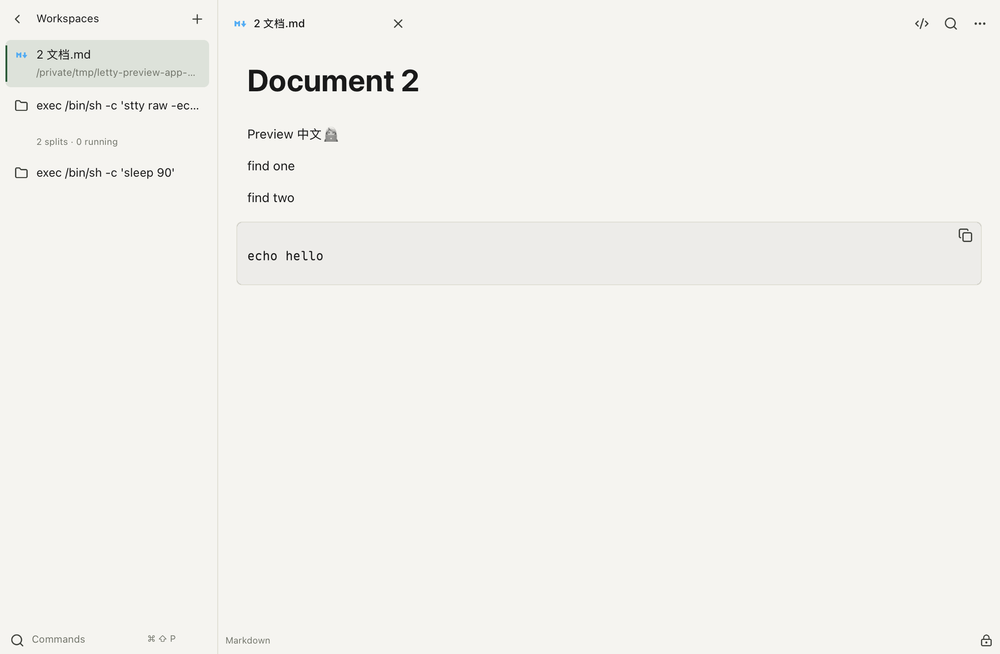

# Letty

Letty is a Zig terminal application built with nanoui and Ghostty's native VT engine. It targets x86_64 Linux and includes an Apple Silicon macOS development preview. Each window contains terminal and file workspaces; terminal panes own independent PTYs and VT state.



Windows, workspaces, split panes and PTYs grow with available system resources. Local files and Markdown open in independent workspaces with language-specific icons, alongside terminal sessions. The Linux GUI can display locally or through SSH X11 forwarding.

The Linux baseline is **Linux 3.10+, glibc 2.17+, GTK 3.22.30+, GLib 2.56.1+, and Cairo 1.15.12+**, with a baseline x86_64 CPU and an X11 display. Compatibility depends on these interfaces and libraries rather than a particular distribution. See [system requirements](docs/compatibility.md) for validation limits.

The default font is **Maple Mono Normal NL NF CN**, bundled with the application in regular, bold, italic and bold-italic styles, including Chinese and Nerd Font glyphs. No system font installation is required. The default theme is **Paper (Otty)**. Customize themes, system font families, spacing, padding, cursors, and bindings in `~/.config/letty/config`; reload without restarting PTYs. See [configuration](docs/configuration.md).

Implemented features include platform-appropriate local shells, system OpenSSH profiles, CJK/combining characters, keyboard/mouse encoding, selection, asynchronous paste, bounded history, incremental search, a command palette, tab rename/reorder/focus memory, four-way splits, zoom/equalize, layout restoration into new sessions, probes, core checks, and versioned user-directory installation.

Builds use Zig 0.17.0 and Ghostty's native Zig API. The [latest local validation](docs/dynamic-workspaces-2026-10-20.md) passed 224 unit tests, 789 native UI checks and 785 portable UI checks. All nine Linux binaries passed static ABI checks. **Target Linux execution, IME behavior, and target performance comparisons remain pending.** GitHub Actions runs Linux build and regression checks; distribution requires the separate complete native release gate.

## Test on Linux

Download a versioned Linux x86_64 archive from [GitHub Releases](https://github.com/BeriBeli/letty/releases). Tagged releases are built, verified and published by GitHub Actions; see the [release workflow](docs/github-releases.md).

Extract the runtime package and enter its directory:

```bash
sha256sum -c SHA256SUMS
./tools/test-centos.sh probe
./tools/test-centos.sh core
./tools/test-centos.sh gui 2>letty-stderr.log
```

Follow the [Linux acceptance checklist](docs/linux-testing.md). Use `./tools/test-centos.sh collect` after a failure. The script's historical name and `el7` package suffix identify existing tooling/artifacts; they do not impose a distribution requirement. Runtime packages need no Zig, Python, sudo, or glibc upgrade.

## Default Linux shortcuts

| Action | Shortcut |
|---|---|
| New window | Ctrl+Shift+N |
| New / next tab | Ctrl+Shift+T / Ctrl+Tab |
| Split right / down | Ctrl+Shift+D / Ctrl+Shift+E |
| Next / previous pane | Ctrl+Shift+] / Ctrl+Shift+[ |
| Close pane | Ctrl+Shift+W |
| Copy / paste | Ctrl+Shift+C / Ctrl+Shift+V |
| Command palette | Ctrl+Shift+P (macOS Cmd+Shift+P) |
| Open / close search | Ctrl+Shift+F / Escape |
| Increase / decrease font size | Ctrl+Shift+Plus / Ctrl+Shift+Minus |
| Save layout / reload configuration | Ctrl+Shift+S / Ctrl+Shift+, |
| Settings | Ctrl+, (macOS Cmd+,) |
| Open local file workspace | Ctrl+Shift+O (macOS Cmd+O) |
| Preview a path shown in the terminal | Ctrl+click (macOS Cmd+click) |

Drag to select, double-click words, triple-click lines, and use the wheel for history. Hold Shift to select/scroll when a TUI enables mouse tracking. Windows, workspaces, split panes and PTYs grow on demand, with capacity determined by available memory, file descriptors and operating-system resources. Per-session history and input queues remain bounded. Layout restoration creates new processes.

## Build

On macOS, run `./script/build_and_run.sh` or use Run in Codex. Open `dist/Letty.app` directly; an Apple Silicon preview ZIP is also produced. Both platforms use nanoui. See the [macOS preview guide](docs/macos-preview.md).

Builds require Python 3, network access, and exactly Zig 0.17.0. `deps.lock.json` pins toolchain/source URLs and digests. Bootstrap writes to the project cache. Supported build hosts are macOS Apple Silicon and Ubuntu x86_64; no local amd64 container is used.

```bash
python3 tools/bootstrap.py
python3 tools/build.py
python3 tools/audit-elf.py zig-out/linux/bin
```

`tools/build.py --native` builds the native Zig GUI and runs unit, core, replay, and boundary checks. The active build has no C VT bridge or backend selector. An independently restored C baseline is retained as a local recovery archive, outside Git; see [recovery](docs/c-vt-recovery.md). Distribution packaging with `python3 tools/package.py` requires current release-gate, hidden UI, startup, and stability evidence. Use `--skip-bootstrap --zig=/path/to/zig` to reuse the exact compiler. Linux remains `x86_64-linux.3.10-gnu.2.17` with `baseline` CPU.

`.github/workflows/linux.yml` builds on an `ubuntu-24.04` x64 runner, audits the ABI, runs Xvfb smoke, hidden UI and lifecycle checks, and verifies current Linux release evidence. A `vX.Y.Z` tag invokes `.github/workflows/release.yml` to package that exact version and publish its archives and checksums. Historical receipts cannot certify a new commit. Source checkouts restore locked dependencies through bootstrap; compilers, dependency copies, caches and local packages are excluded from Git.

## Documentation and releases

Start with the [documentation index](docs/README.md), [architecture](docs/architecture.md), [validation history](docs/validation.md), and [performance methodology](docs/performance.md).

For development, see [Contributing](CONTRIBUTING.md) and the [third-party notices](THIRD_PARTY_NOTICES.md).

M0–M5 cover typed actions, tabs/splits, search/scrolling, menus/diagnostics/close confirmation, PRIMARY/paste protection/HTTP(S)/OSC 8, and local shell/CWD/task/focus integration. See the [feature gap plan](docs/ghostty-nanoui-gap-plan.md).

M6–M8 add multiple windows, configuration/key sequences, shaping/fallback, and CPU damage rendering. The historical M8 gate passed 110 model, 46 core, 526 native UI, 522 portable UI, and 288 pixel comparisons; nine Linux ELF files required at most GLIBC_2.17. See the [M8 release](docs/m8-release.md).

The frozen M9–M11 integration adds Kitty images, themes/Inspector/OSC 52/drops, hotkeys/Quick Terminal/accessibility foundations, Settings, and optional sidebar navigation. Its recorded local gate passed 190 model, 46 core, 675 native UI, and 671 portable UI checks. Git/port collection is off by default. See the [integration release](docs/m9-m11-release.md) and the subsequent [local file/Markdown preview guide](docs/file-markdown-preview.md). Historical receipts describe their own frozen source rather than certifying the current tree.
