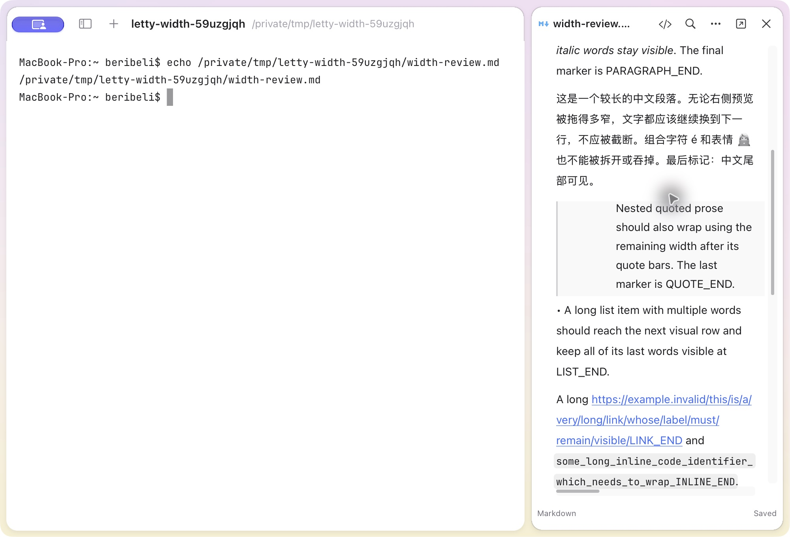
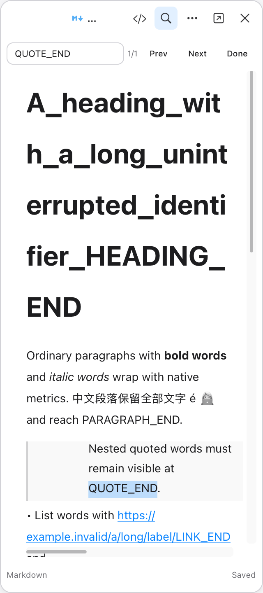
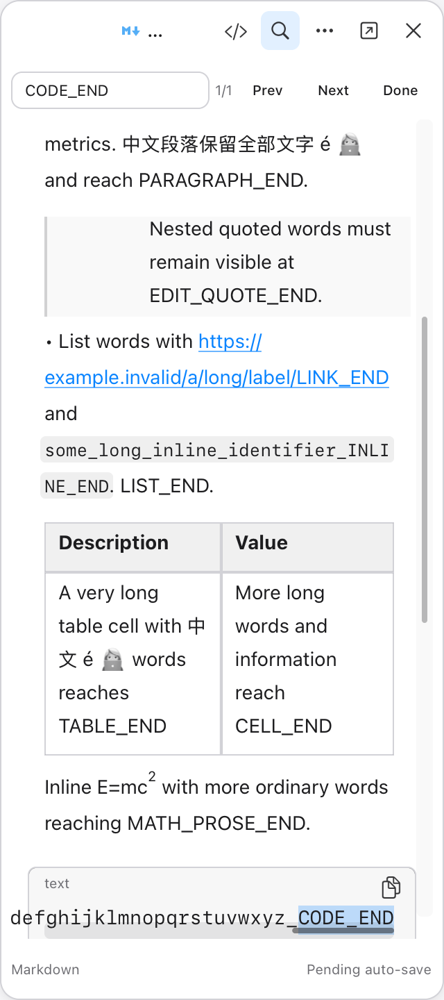
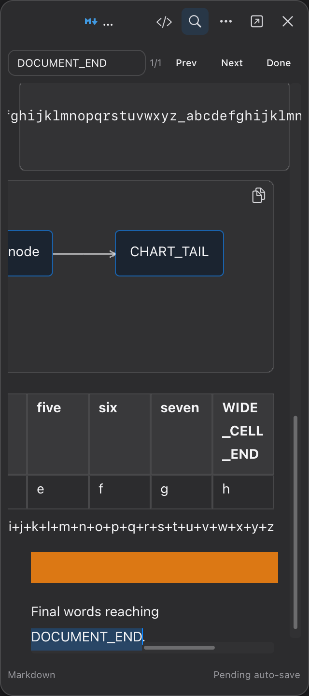
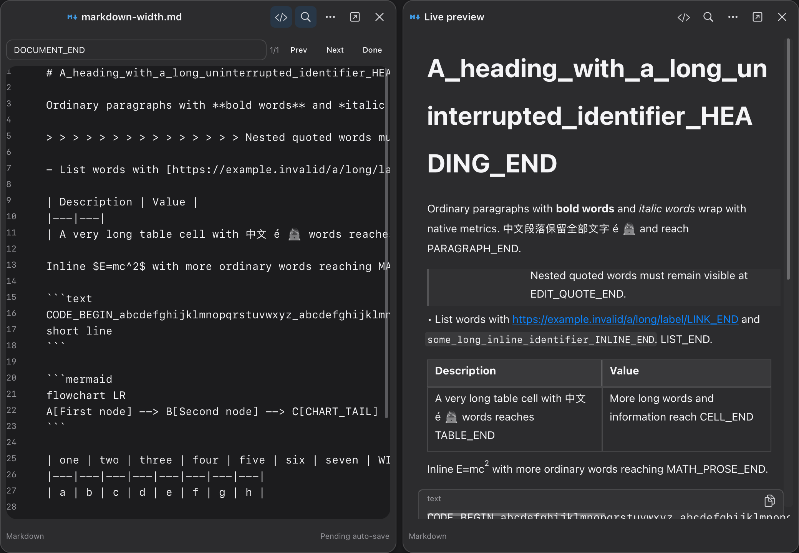

# Rendered Markdown width repair, 2026-10-24

The active document implementation is `src/runtime/document/`; `src/preview/`
is the preceding implementation. This change preserves rendered editing and
automatic saves to the original Markdown file after 500 ms of inactivity.

## Findings against v0.2.3

The v0.2.3 renderer and the active renderer both use native attributed text
metrics and grapheme-safe prose wrapping. The ordinary English and Chinese
paragraph fixture already wrapped when the real side preview was dragged
from 440 to 320 points. That experiment does not establish the cause of every
user document's clipping; no actual failing user document was supplied.

A separate reproducible failure affected deeply nested quotes: the inherited
`quote_depth * font_size * 1.3` indentation consumed almost the entire narrow
reading area. Fifteen quote levels left one point for wrapping and painted
letters outside the right edge. Each depth also added an accent-colored bar.
Indentation now compresses to at most 30% of the available reading width, and
quotes use one subtle gray rule. This bound applies to wrapping, drawing,
tables, selection, pointer hit testing and caret placement.

Horizontal resource scrolling also used to shift shorter tables, fitted images
and prose caret/IME geometry off screen. Prose now stays fixed; each resource
clamps the shared pan to its own overflow. All lines in a code block share
the same block width. Markdown text zoom preserves embedded image fitting.
Find reveals the full image height for image-only rows. Source and passive
preview have distinct widget IDs so their final layout rectangles remain
independent.

Scroll tracks accept pointer dragging, track clicks, arrow keys, Home/End and
Page Up/Down. Shift-wheel pans horizontally. Body selection and IME focus do
not get redirected when a track consumes input.

## Evidence and scope

The integrated owned-window regression covers 240/320/640 point layouts,
wide/narrow/wide cache changes, zoom, long headings and links, Chinese,
combining accents, emoji, inline code, deep quotes, lists, wrapped and wide
tables, code, math, Mermaid, fitted images, Find tails, optimistic edits,
background reconciliation, caret/IME geometry and split preview identities.
Visible native app testing independently dragged a private side preview to
320 points and verified the quote, paragraph and table tails. Window border
resizing was not established by that interactive experiment.

Current source-bound receipts are stored in
`.cache/verification/markdown-width-current.json`; immutable evidence is
identified by that receipt. Static Linux ABI checks do not establish Linux
runtime, X11/VDI, system IME or NFS acceptance.

