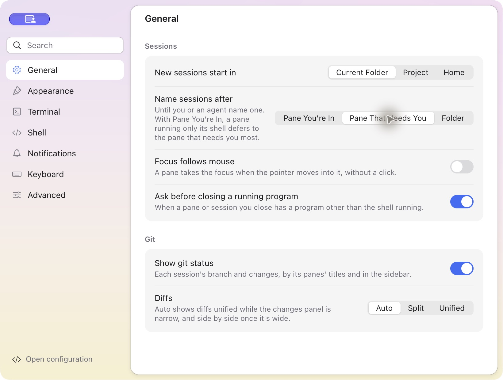

# Settings

## Current application

Open Settings with Cmd+, on macOS or Ctrl+, on Linux. Settings has one shared
window and does not create a PTY. Its seven pages are General, Appearance,
Terminal, Shell, Notifications, Keyboard and Advanced.

Each accepted choice, toggle, text-field commit, shortcut edit or submitted
environment edit is validated, atomically saved to the selected key=value
configuration and applied immediately. There is no Cancel / Save and apply
header, separate Settings Save command or unsaved-changes confirmation after a
successful edit. Closing and reopening retains the saved values. Startup-only
settings affect newly created sessions; existing processes keep running.

A candidate is published only after validation and persistence succeed. Invalid
values, write failures and externally changed configuration preserve the last
working settings and show an error. Use Advanced → Reload to adopt external
changes before editing again. Reload and reopening invalidate old queued
settings actions; consecutive edits in the same session remain valid. Lowering
the scrollback limit takes effect after that edit is successfully saved and may
discard older history. An unchanged edit does not rewrite the configuration.

The regression changes General → Name sessions after to Pane That Needs You
through the actual native window. The private file contains `session-name = lead`
without using Save; closing, reopening and restarting retain the selection.
The captured header remains free of submission buttons.

The [preceding Settings guide](archive/settings-pre-runtime.md) records the older
draft/save workflow and its separate test harness. See the
[implementation scope](implementation-scope.md) for current platform limits.
