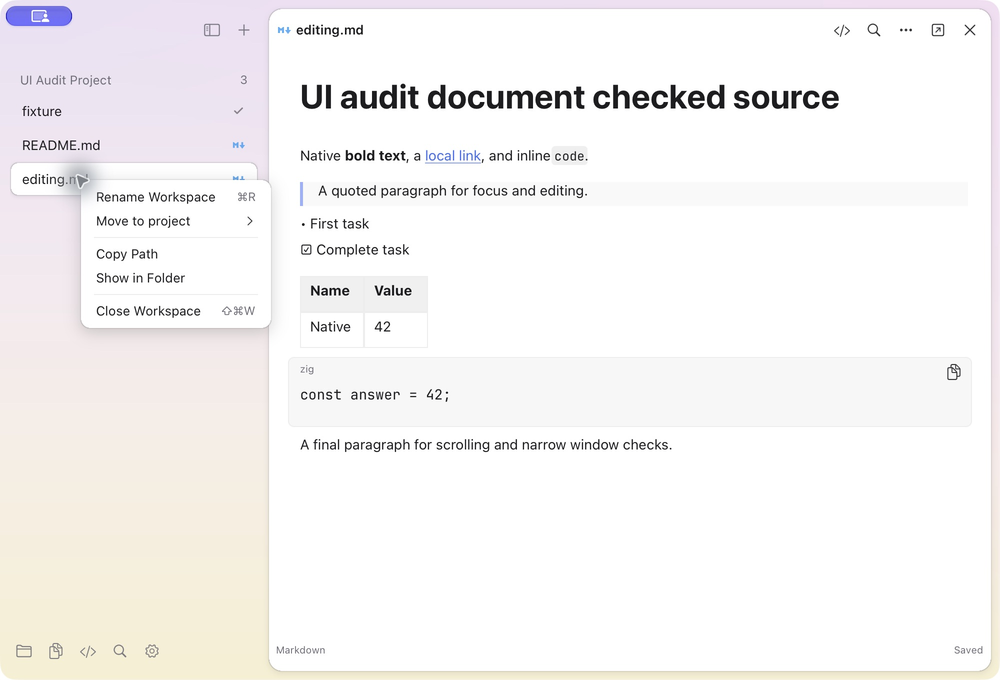
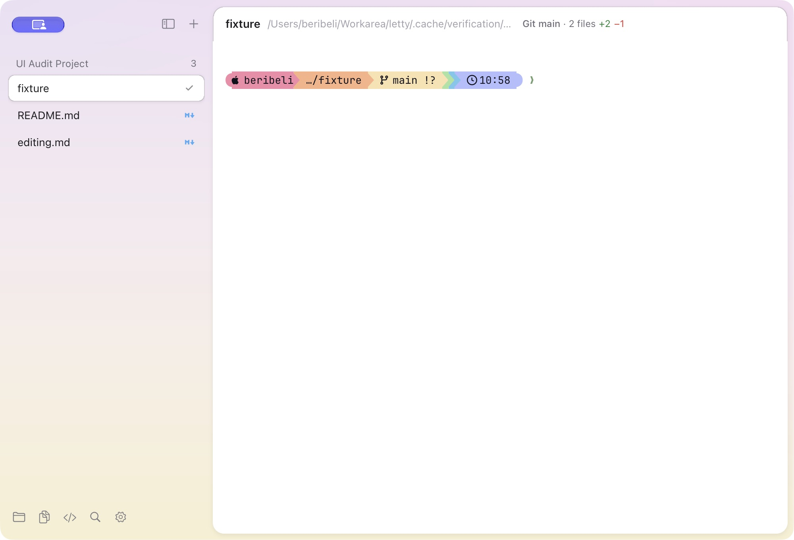
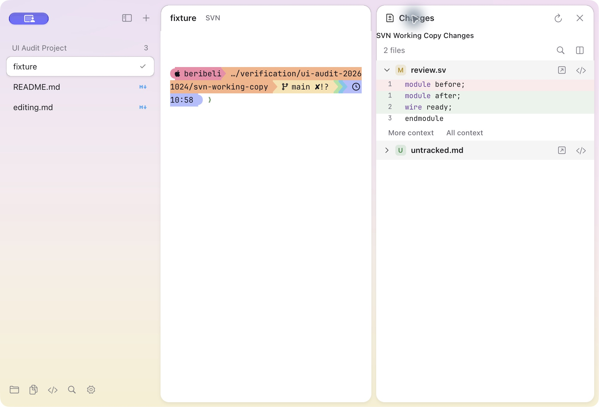

# Letty UI audit and repairs — 2026-10-24

Follow-up: the later Settings change removes the earlier draft submission
workflow. Accepted settings edits now save and apply immediately; see the
[active Settings behavior](settings-window.md#active-zig-port). The captures
and receipts below retain their original audit source identity.

This audit reproduced the supplied sidebar-menu problem in the running Letty
preview, inspected the installed Kero application, checked the corresponding
upstream source, and exercised repairs in an owned Letty window. Screenshots
were captured through CUA, saved, and inspected. Private file, configuration,
Git and PTY fixtures kept the audit separate from user documents and terminals.

## Reference identity

The installed Kero application reports **2.1.12** in both Info.plist and its live
Settings page. Upstream [v2.1.12](https://github.com/egoist/kero/tree/5747eb5442e4911c72f152db35fd3490f6ab585c)
resolves to `5747eb5442e4911c72f152db35fd3490f6ab585c`. The inspected
[main source](https://github.com/egoist/kero/tree/7e109f612ec8a61007f37b6fdabac8cfbcb32be9)
is `7e109f612ec8a61007f37b6fdabac8cfbcb32be9`; its parent is that release and
its changes concern release workflow/documentation. The original port's
2.1.10 inventory remains historical and has not been relabeled.

Kero's `view.go` session menu uses compact native rows, left-aligned labels,
separators, optional status actions and a project submenu. Its `palette.go`
caps populated palettes at 460 points but shrinks empty results. Settings
controls use intrinsic choice widths; the Background heading-to-grid gap is
8 points. These observations informed the fixes below. Letty draws its menus
with nanoui, so this is not a claim of identical AppKit materials or pixels.

## Flow, findings and repairs

| Step | Observed problem | Repair and verification | Health |
| --- | --- | --- | --- |
| 1. Open a sidebar file menu | A fixed 500-point column, centered buttons and terminal-only actions appeared for README.md. | Shared content-sized menu, 24-point left-aligned rows, separators, shortcut hints, viewport clamping and scrolling. File workspaces expose Rename Workspace, Move to project, Copy Path, Show in Folder and Close Workspace. Deferred file actions validate document identity/generation. | Repaired |
| 2. Open terminal/project actions | Project headers lacked the corresponding rename/menu interaction. | Terminal and project menus use the same compact control. Project rename persists a display alias without changing directory or PTY ownership; actual header dragging moves the group. Keyboard selection skips disabled rows and separators. | Repaired |
| 3. Submit an inline project name | A real-window test found Enter also reaching the terminal after closing the name field. | Input ownership is captured at the start of the frame; submitting or cancelling a rename cannot become terminal input later in that frame. Regression checks and a private live shell verify it. | Repaired |
| 4. Search the command palette | Empty results left a tall, unexplained blank panel. | The palette shows No matches in a content-sized panel, scrolls keyboard selection into view and dismisses outside clicks without activating controls underneath. File commands use workspace names. | Repaired |
| 5. Inspect Appearance and choices | Choice arrows were far from values, a three-item language menu contained unnecessary search space, and the background section gap was too large. | Intrinsic choice faces, compact checked choice menus and the source's 8-point grid gap. Search remains available for long font/theme catalogs. | Repaired |
| 6. Inspect Shell, Advanced and Keyboard | Environment editing lacked a clear affordance; Advanced lacked a configuration card; shortcut category headings repeated. | Environment and configuration cards expose the existing editor/Open/Reload actions. Keyboard actions are grouped once per normalized category and use Letty's product name. | Repaired |
| 7. Resize, split, zoom and review | Narrow windows required a second sidebar shortcut because stored visibility differed from effective visibility. | Toggle now uses effective visibility. Context menus fit a 480×240 viewport. Owned-window checks cover split/zoom/restore and private Git review/editor navigation. | Repaired; platform limits below |
| 8. Open and edit Markdown | The supplied README contains HTML wrappers that appear as text. | This parser intentionally does not interpret HTML. Native Markdown rendering and its automatic document saves remain supported; see the explicit boundary below. | Known limitation |
| 9. Start the user's default zsh/Starship | Live comparison in the same private Git directory showed dark Powerline separators, unlike Kero's continuous pastel segments. | Minimum contrast incorrectly recolored graphical glyphs. Terminal graphics now retain their ANSI foreground colors using the pinned Ghostty exemption; mixed text/graphics runs split at the policy boundary. Ordinary letters still receive minimum contrast. | Repaired; live and pixel checks required below |
| 10. Inspect repository information | The terminal header displayed a title/path but omitted Git/SVN data already owned by the Changes backend. | A compact header badge shows the Git branch and change totals, or SVN working-copy/file status. Clicking resolves the stable pane and opens its Changes view. Real local cwd lookup supports shells without OSC 7. | Repaired; backend and live checks below |
| 11. Select one of many changed files | The real SVN regression selected the final row instead of the clicked file. Every file header had the same explicit control key, overriding its pending path key. | File headers now consume the unique path key. This also fixes the corresponding Git rows and their child Open/Edit controls. The real multi-file SVN click remains a regression check. | Repaired; final real-SVN gate below |
| 12. Restore a long project list | A 36-document GUI launch exhausted macOS's inherited 256-descriptor soft limit, producing EditorNotification/JobPipe errors. The owned process had descriptors through 255 open. | Startup raises only this process's soft NOFILE limit to the host allowance (Darwin OPEN_MAX), retaining the hard limit and existing four-job bounds. A 36-document capacity check and live long-list retry cover the failure. | Repaired; capacity gate below |

| 13. Click Changes after a default-shell `cd` | Discovery used the real shell cwd, but deferred file actions still checked the startup/OSC directory. Same-owner refreshes also invalidated queued clicks. | File-action validation now uses the same real-cwd probe as discovery. Ownership epochs change for owner/directory/backend transitions; backend job generations and patch versions continue to reject stale results. | Repaired; no-OSC and live SVN checks below |

The shared menu implementation is in `src/runtime/menu.zig`; routing, project
ownership and input guards are in `desktop.zig`. Persistent aliases live in
`ui_state.zig`; choice geometry in `preferences.zig`; shortcut grouping in
`input_settings.zig`; terminal actions in `terminal_menu.zig`. Tests exercise
corners, short/long menus, disabled choices, submenu keyboard return, outside
dismissal, stable document actions and preservation of terminal PTYs.

## Starship correction

The first default-zsh observation established that the shell started, but did
not establish prompt fidelity. The user correctly challenged that conclusion.
A separate Kero session was created, changed to the same private Git fixture,
captured, and then closed without changing the existing Kero session.

The user's Starship format intentionally includes three Powerline separators
between Git/language/environment/time sections, even when the optional modules
are empty. Their presence is correct. Their **darkened colors in Letty** were
incorrect: `render.zig` applied minimum contrast indiscriminately. Ghostty's
pinned `renderer/cell.zig` exempts box drawing, block elements, Powerline and
legacy-computing graphics. Letty now follows those ranges and preserves the
foreground/background transitions. The user's zsh and Starship configuration
files were not modified.

The regression fixture places `AB` under one ANSI style at minimum contrast 3.
It checks that the letters retain contrast correction, the arrow keeps its
original RGB color, and pixels painted by the actual renderer contain that
color. This catches the original bug and incorrect run-wide exemptions.
The observed `<200d>` expansion while editing a joined emoji is recorded
separately; it does not establish full shell-editor emoji compatibility.

## Repository header and refresh

The header now consumes the existing bounded Git/SVN job state. Git summaries
include the branch, changed-file count and measured added/removed lines. SVN
summaries identify the working copy and changed-file count; no Git branch or
unmeasured line totals are invented. A missing SVN executable is reported by
the Changes backend rather than treated as a clean working copy.
The private SVN working copy is nested under the Letty Git checkout, so the
unchanged Starship configuration can independently show that outer Git branch.
Letty's own badge selects the nearer SVN metadata; the prompt is not rewritten.

The Git/SVN setting controls badge visibility and repository summaries in sidebar
row tooltips. Narrow panes use a compact label;
very small pane headers omit the badge to retain usable terminal controls.
Clicking a badge targets that exact window/workspace/pane and opens Changes.

The existing local foreground-process probe supplies the shell's actual cwd
when no OSC 7 directory is available. Repository refreshes coalesce after output
with a single 250 ms timer per pane, and still refresh on focus/explicit actions.
There is no periodic idle scan. Closing the pane cancels the timer and its owned
jobs. Metadata discovery never changes the PTY's startup directory or ownership.
Deferred review actions use the same cwd probe, and routine same-owner refreshes
retain their UI ownership stamp. Current file membership is revalidated before
selection; patch-specific actions additionally validate the patch version.

The long-list fixture also checks startup resources. File descriptors are
per-process OS resources, not a workspace count limit. The application uses the
already permitted descriptor allowance; it does not modify launchctl, system
limits or the hard limit. Descriptor exhaustion under a stricter host hard
limit remains a real resource failure, not evidence of unlimited capacity.

## Markdown and HTML boundary

The file preview is a Letty extension. The inspected Kero `side.go` describes
its Files view as future work, so there is no Kero Markdown preview used as a
parity reference here.

`src/runtime/document/markdown.zig` excludes HTML and entity interpretation.
Consequently `
`, `<h1>` and `` in the nanoui README are currently literal
text, including their attributes. Native Markdown headings and safe local
images written with Markdown image syntax are a different supported path.
This audit does not claim HTML layout, remote image fetching, script execution,
CSS or embedded browser support. It did not add an executable HTML renderer.

Markdown body and Source edits retain the separately implemented 500 ms
automatic saving behavior. There is no Markdown Save button. Settings drafts
and the Git review editor have their own save behavior; their controls should
not be confused with document autosave. See [active file/Markdown documents](file-markdown-documents.md).

## Accessibility and acceptance limits

The repaired menus support arrows, Home/End, Enter, Escape and submenu return;
disabled items cannot activate. Keyboard and pointer checks supplement the
screenshots. The current Letty AppKit accessibility snapshot exposes the window
and standard window controls, but does not expose all nanoui-drawn controls as
native accessibility elements. Full VoiceOver support and accessibility
compliance are **not** established by this audit.

Native macOS and portable-on-macOS checks do not establish real target Linux,
X11/VDI, NFS or system IME acceptance. A Linux cross-build and ELF dependency
audit establish build/ABI facts only. All preview bundles remain development
artifacts, not a completed production release.

## Evidence

The completed source identity, command outcomes, executable hashes and accepted
screenshot hashes are recorded in `.cache/verification/ui-audit-current.json`.
Immutable history preserves earlier autosave and UI checkpoints separately.
The source identity in `dist/LettyPort.app/Contents/Resources/development-port.json`
must match the final native receipts. Earlier screenshots and logs certify only
their recorded checkpoints.

### Accepted captures

The Starship, Git/SVN, Markdown, file-menu and Appearance captures below were
repeated with source `8890a2394d4ec316131f975eae9cc0675bf3c8f4ce6f9d0409e6c35445414cba`.
The long-menu, project-rename and empty-palette captures retain the `6ca90a34`
checkpoint identity; those screens were not recaptured for the final cwd guard.
Keyboard/Shell/Advanced and source-Find captures retain their `c119` checkpoint
identity. Checkpoint captures illustrate their tested revision, not a later binary.

| Evidence | Capture |
| --- | --- |
| Supplied oversized menu | [Before](assets/kero-ui/audit-20261024/before-file-menu.png) |
| Kero 2.1.12 session menu | [Reference](assets/kero-ui/audit-20261024/kero-session-menu.png) |
| File menu after repair | [Final](assets/kero-ui/audit-20261024/after-file-menu.png) |
| Long submenu, End selects Project-33 | [6ca90a34 checkpoint](assets/kero-ui/audit-20261024/after-long-project-menu.png) |
| Project alias submitted without an extra shell prompt | [6ca90a34 checkpoint](assets/kero-ui/audit-20261024/after-project-rename.png) |
| Empty palette | [6ca90a34 checkpoint](assets/kero-ui/audit-20261024/after-empty-palette.png) |
| Kero Appearance | [Reference](assets/kero-ui/audit-20261024/kero-appearance.png) |
| Appearance and compact language menu | [Final Appearance](assets/kero-ui/audit-20261024/after-appearance.png), [Final menu](assets/kero-ui/audit-20261024/after-language-menu.png) |
| Starship before correction | [Before](assets/kero-ui/audit-20261024/before-starship.png) |
| Kero with the same Starship configuration and directory | [Reference](assets/kero-ui/audit-20261024/kero-starship.png) |
| Default zsh with corrected Starship and Git header | [Final](assets/kero-ui/audit-20261024/after-starship-git.png) |
| Default zsh after cd to a real SVN working copy | [Final header](assets/kero-ui/audit-20261024/after-svn-header.png), [Final diff](assets/kero-ui/audit-20261024/after-svn-diff.png) |
| Clicking an unversioned SVN file after cd | [Final selection and explicit BASE limitation](assets/kero-ui/audit-20261024/after-svn-selection.png) |
| Native Markdown, retained saved source | [Final](assets/kero-ui/audit-20261024/after-markdown.png) |
| Markdown Source Find | [c119 checkpoint](assets/kero-ui/audit-20261024/source-find-checkpoint.png) |

### Final verification

Final verification results are bound to the source and executable hashes in the
receipt; no release or target-runtime acceptance is implied.

| Check | Result |
| --- | --- |
| Zig | Exactly 0.17.0 |
| Native build | Passed; 77 unit, 69 document, 5 core checks |
| Native UI | 185 checks passed, including Starship pixels, no-OSC cwd selection and 36-document capacity |
| Portable native build/UI | Passed; 77 unit, 69 document, 5 core and 185 UI checks |
| Real private SVN repository and native UI | 11 integration checks passed; SVN 1.14.5 |
| Linux cross-build and ELF ABI | Passed for current manifest binaries; baseline CPU, ReleaseSafe, VT SIMD disabled, glibc ≤ 2.17. No target-runtime execution |
| Signed preview | `dist/LettyPort.app`; current native source identity |
