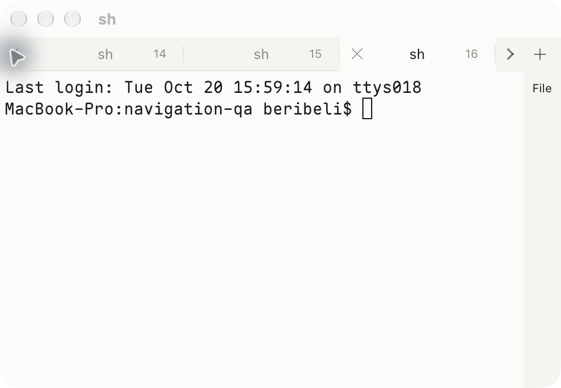
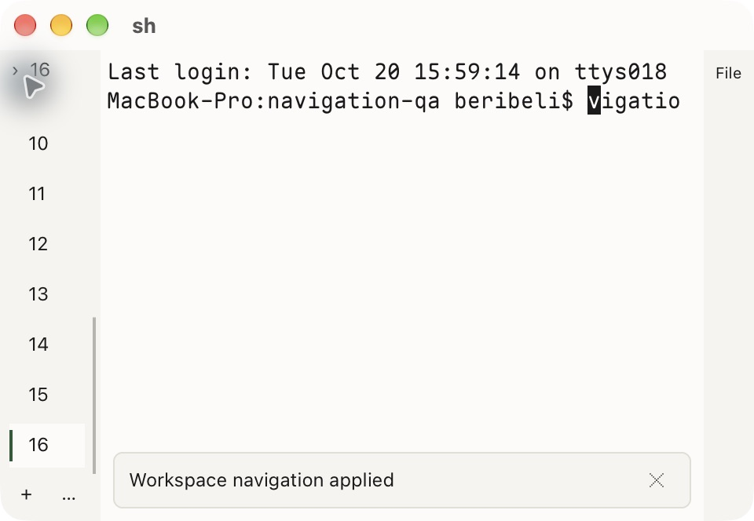

# Workspace navigation and preview validation — 2026-10-20

The workspace tab limit is now sixteen per window. Compact navigation remains usable after collapsing the sidebar, the preview has a persistent open/show entry, and top navigation places New Tab immediately after the tabs.

## Behavior and resource ownership

The sidebar's workspace rows represent terminal tabs. A tab owns a split tree of PTY panes; preview documents belong to a separate bounded dock. Increasing the tab limit does not increase the application-wide sixteen-PTY budget or the eight-window limit. A window can contain sixteen tabs only when the remaining application PTY budget permits it. Splits and other windows consume the same budget, and an additional tab fails with an explicit limit message.

- The 64-pixel compact sidebar shows a total count, numbered rows, active selection, attention dots, full metadata on hover, a scrollbar, and persistent New Workspace and Commands controls. Selecting a compact row returns input to its terminal.
- The right edge always offers File when no preview exists, or Show when an existing preview is hidden. The preview's edge chevron, View menu, command palette, and `toggle_file_preview` action share visibility behavior. Defaults are Cmd+Shift+O on macOS and Ctrl+Alt+O on Linux.
- Hiding a preview retains its document identity, mode, and reading position in memory, releases its displayed image keys, and returns input to the terminal. Delayed accessibility actions revalidate the active tab, document, and generation.
- Top mode keeps the strip visible with one tab under `tab-bar = auto`. New Tab follows the tab list; overflow arrows keep later tabs reachable in a narrow window. Explicit `tab-bar = never` still hides it. The native macOS title bar remains the system title bar.
- Number labels and palette navigation extend through sixteen. Existing Cmd+1 through Cmd+8 defaults remain unchanged. Layout decoding accepts legacy eight-slot arrays, including encoded byte-string roots; saving uses the expanded bounded arrays.

The shared split forest remains bounded: with at most sixteen panes, its node count is `2 × panes − tabs`, never more than thirty-one. Preview limits remain four documents per tab and sixteen per application. Layout restore recreates terminal processes; preview reading state is not persisted across application restarts.

## Recorded source and checks

All final build and test receipts below identify source SHA-256:

```text
6db70ef5bea4e8a5f045bcb6a5434268d90928b5106a981526114ccaf782f00b
```

[Evidence snapshot](assets/navigation-2026-10-20/evidence.json) preserves build configuration, suite receipts, and screenshot hashes. The compiler was Zig 0.17.0. Builds and verification ran serially against stable source.

| Scope | Result | What it establishes |
| --- | --- | --- |
| Native macOS build | Passed | 213 unit checks, 49 core checks, and VT replay, N2, protocol, boundary, and graphics suites |
| Native macOS hidden UI | Passed, 751 checks | Application layout, navigation, preview, focus, input routing, and regression checks |
| Portable renderer on macOS | Build and hidden UI passed, 747 UI checks | Portable rendering and application regressions on this host |
| Visible native macOS window | Targeted checks passed | Compact selection, preview open/hide/show and reading-position retention, sixteen real terminals, rejection of a seventeenth, and sixteen-tab restore |
| Final native binary at 480-pixel window width | Passed | Restored sixteen tabs, selected the last tab through overflow navigation, and displayed compact overflow rows with active selection |
| Linux delivery cross-build | Passed | `x86_64-linux.3.10-gnu.2.17`, baseline CPU, ReleaseSafe, VT SIMD disabled |
| Linux static ELF audit | Passed for nine binaries | Maximum required GLIBC version 2.17; no execution on the target |

Regression coverage includes compact control hit rectangles, New Tab adjacency, the single-tab auto strip, sixteen-tab serialization, legacy restore, resource-budget exhaustion, stable identity checks for deferred preview actions, and preview state across visibility changes. Existing suites exercise tab reorder, terminal input isolation, split geometry, scrolling, and resize-related layout.

Commands used:

```sh
python3 tools/build.py --native --skip-bootstrap --zig=/opt/homebrew/bin/zig
python3 tools/verify-ui.py --prefix=native
python3 tools/build.py --native --portable --skip-bootstrap --zig=/opt/homebrew/bin/zig
python3 tools/verify-ui.py --prefix=native-portable
python3 tools/build.py --skip-bootstrap --zig=/opt/homebrew/bin/zig
python3 tools/audit-elf.py zig-out/linux/bin
```

Full local logs are `.cache/navigation-final-{native-build,native-ui,portable-build,portable-ui,linux-build,linux-audit}.log`. PTY suites ran with permission to spawn and reap their own children. Visible checks used an isolated QA app, private configuration and fixtures, and owned shell processes.

## Rendered evidence

These two images are captures of visible native macOS windows using the final binary:





The following are hidden/offscreen rendered fixtures from the final verification run, not desktop interaction captures:

- [One-tab top strip, portable renderer](assets/navigation-2026-10-20/top-one-hidden.png)
- [Two-tab top strip, portable renderer](assets/navigation-2026-10-20/top-two-hidden.png)
- [Open preview, native renderer](assets/navigation-2026-10-20/preview-hidden.png)

## Acceptance boundaries

The final desktop captures establish the overflow and compact presentation. The broader preview reading-position and terminal-selection interactions were also exercised on an earlier build with the same preview implementation; final hidden UI checks cover the final source. Counts do not substitute for desktop acceptance.

Native mouse-wheel scrolling and interactive edge-resizing were not conclusively established by the desktop automation. Hidden scroll/resize checks passed. Full screen-reader and platform IME acceptance remain outside this run.

Linux binaries were cross-compiled and statically audited on macOS. Actual target Linux, X11/VDI, dynamic library loading, kernel paths, and target IME behavior still require target acceptance.

The packaged app is an ad-hoc signed local developer preview. The full native distribution release gate and notarization were not applied. Historical receipts and versioned recovery packages retain their original hashes; this report does not recertify them.
