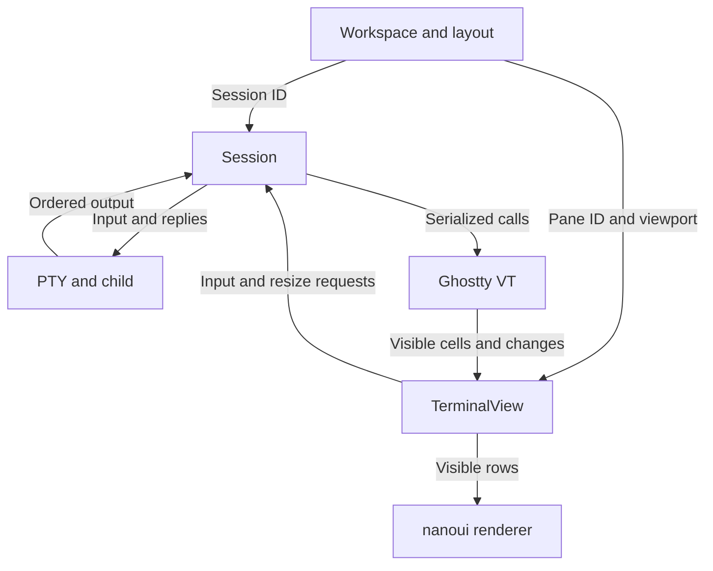

# Terminal development plan: macOS development and baseline Linux runtime

Version: 2026-10-19. This is the original staged plan, retained as design history. Current implementation/use is governed by [README](README.md), deps.lock.json, [validation](docs/validation.md), and [Linux acceptance](docs/linux-testing.md). Its schedule and original milestone numbers do not certify target execution.

Implementation update: all components use **Zig 0.17.0**, Ghostty commit `5064b3265e500d55f5f44ff48ca59b8685543bb8` from official migration PR #14519, and nanoui `e4d53be8b216efa66a800bf3093d6c1cb83bbd8d`. The former two-toolchain proposal was dropped. Defaults are Maple Mono Normal NL NF CN and original Otty Paper. The historical C VT integration was later replaced by validated native Zig; see the [migration record](docs/native-zig-vt-adaptation-plan.md).

## 1. Goal and environment

Build a lightweight Letty terminal using nanoui UI and Ghostty VT. Target ordinary Linux shell/TUI work first, then multiple sessions and selected Tern-inspired ideas. The memory goal is to beat Konsole 2.10.5 under equivalent workloads while retaining acceptable input/scroll/X11 behavior; no unmeasured advantage is claimed.

Workflow: **local macOS development → native x86_64 Linux GitHub Actions build/test/package → target Linux acceptance**, without a local amd64 container.

| Environment | Responsibility | What it establishes |
|---|---|---|
| macOS Apple Silicon | Edit/debug/core logic/native preview | Platform-independent logic and macOS behavior |
| Recorded ubuntu-24.04 x64 runner | Locked downloads/build/tests/artifacts | Reproducibility/static ELF ABI/modern Linux/Xvfb checks |
| Target x86_64 Linux | GUI/PTy/shell/compatibility/performance | Actual kernel/library/workload behavior |
| Actual local or SSH X11 display | Input/IME/focus/clipboard/presentation | Real display and input behavior |

Pinning a runner label avoids an ubuntu-latest major-version change, but record the actual runner image because it still updates [S1]. Runtime requirements are distribution-independent and centralized in [compatibility](docs/compatibility.md): baseline x86_64, Linux 3.10+, glibc 2.17+, GTK 3.22.30+, GLib 2.56.1+, Cairo 1.15.12+, and X11. The original kernel observation was 3.10.0-1160; a vendor kernel build string is not a required OS identity.

The GUI runs on the Linux host, displaying locally or through SSH X11. Its first PTY starts a local shell; subsequent remote connections use the system OpenSSH client/config/agent/known_hosts [S3]. Moving the GUI to another machine changes resource accounting and must be recorded as an architectural change, not silently substituted for compatibility.

Initial scope: one OS window, local shell, selection/copy/paste, CJK rendering and actual IME, resize, bounded history/search, fonts/colors, tabs/splits, clean exit, optional SSH launch profiles. Stable Session/View IDs and bounded queues prepare future separation. Daemon/TSP/plugins/rich views/AI remain independent later work.

## 2. Locked toolchain and compatibility

| Component | Fixed requirement |
|---|---|
| nanoui | e4d53be8b216efa66a800bf3093d6c1cb83bbd8d / Zig 0.17.0 |
| Ghostty VT | 5064b3265e500d55f5f44ff48ca59b8685543bb8 / Zig 0.17.0 |
| Original interface | Matching public include/ghostty/vt.h C ABI; later superseded by native facade |
| Linux target | x86_64-linux.3.10-gnu.2.17, baseline CPU |
| Development target | Native Apple Silicon, built separately |

Initial source inspection was not itself a joint-build result. The pinned migration PR was unmerged when checked. Actual native/Linux builds are recorded separately from target execution. Application/VT/native dependencies must share explicit target requirements; runner-native defaults bypass them.

Build rules:

1. Record exact compiler/source URLs/digests/commits; no floating CI branches. Use a project-specific ZIG or tools/build.py --zig, not an accidental PATH compiler.
2. Begin with ordinary target-code static linking and no cross-toolchain LTO. Historical C ABI values/lengths/handles/freeing sides were explicit; upstream allocation frees through its own API.
3. Contain API/callback/errors in an adapter. Borrowed pointers never survive feed/resize/compression; views read controlled visible snapshots or bounded copies. Active native facade now provides this boundary.
4. nanoui dynamically loads GTK [S7/S8]; add a matching legacy-compatible sysroot only when actual native link inputs require it. Reuse installed GUI libraries and never require upgrading system glibc. List/audit any added shared libraries.

### Linux 3.10 risk

The originally inspected Zig 0.17 standard I/O support baseline was Linux 5.10+, while this target includes 3.10 [S9/S10]. A lower target does not supply all syscall fallbacks. Inspected std.Io.Threaded metadata/length paths use statx, introduced upstream in 4.11 [S11]. nanoui font loading reads file lengths and accesses global_single_threaded.io, so test full font I/O rather than an empty executable or only App's Io [S12].

Observe actual target errors/syscalls because vendor backports differ. Prefer narrow host open/fstat/pread/directory/PTy/random-path compatibility fixes with documented upstream scope/regressions. If a broad standard-library/GUI fork becomes necessary, report concrete failures/cost/options before changing deployment. This risk concerns used runtime paths, not every Zig-built executable.

## 3. CI and packages

Start with one sequential Linux workflow; split only for demonstrated cache/parallel benefit.

| Stage | Work | Failure/output |
|---|---|---|
| Checkout/tools | Locked sources/Zig/version/digest checks | Reject mismatch |
| Build | Probe/VT/current app at explicit target | Record CPU/optimization/commands/logs |
| ABI | All ELF architectures/interpreters/NEEDED/versions/RPATH | Reject >GLIBC_2.17, host paths, wrong architecture |
| Core | VT/PTy/queue/lifecycle | Expected screen/cursor/exit |
| GUI smoke | Xvfb startup/fonts/repaint/exit | Modern Linux behavior only |
| Package | Permission-preserving tar.gz/checksums/build-info | Downloadable candidate and summary |

Audit all binaries, and any libstdc++ version requirements if introduced. NEEDED alone cannot cover dynamically loaded GTK symbols; probe those on target [S8]. Xvfb is useful automation, not native IME/focus/clipboard/display acceptance [S13].

PR/push builds upload identifiable artifacts; cache keys include compiler/target/dependencies. Begin ReleaseSafe; other optimization modes require recorded rebuild/revalidation. Original example naming `terminal-linux-x86_64-el7-<commit>.tar.gz` and current `el7` suffix are artifact identities, not distribution requirements. Transfer downloads to a target user directory; runtime needs no compiler/runner/new build system. If target lacks GitHub access, download elsewhere and transfer.

Publish the exact accepted artifact, with source/commit/digest association rather than rebuilding afterward. Tag/manual releases follow actual acceptance. tar before artifact upload preserves permissions [S2/S29]; pin action versions/commits when implementing. Internal hosts need not be exposed to hosted runners.

Record **CI passed** (actual runner/toolchain checks/static ABI) separately from **target passed** (same artifact on actual baseline kernel/libraries/display). Only target execution establishes old-syscall behavior.

## 4. Architecture

| Owner | State/responsibility |
|---|---|
| App/workspace | Windows/layout/active panes/configuration, stable Session/Pane IDs |
| Session | One PTY/child/VT/history/size/exit/bounded queues, serialized lifecycle |
| VT adapter | Upstream handles/effects/errors/temporary queries |
| TerminalView | Viewport/selection/focus/bounded snapshots/input hits |
| Platform | Files/PTy/event loop/clipboard/IME/compatibility |
| Renderer | Visible glyph/style/damage and bounded caches |

Ghostty supplies parser/state/input encoding/render data, not PTY/SSH/windows/fonts/final drawing [S14]. Current details are in [architecture](docs/architecture.md).

Invariants: one complete VT/history per Session, no second parser/mirror; replies written once per Session rather than per View; ordered complete PTY parsing with nonblocking partial/EAGAIN handling, bounded work/queues and read backpressure, never waiting on main-thread writable capacity. Coalesce rendering, not output bytes. Hidden tabs parse without needless drawing; snapshots remain limited. VT/PTy resize has one order and one primary size per Session. Keep Session independent of window objects for possible later services. Use existing GTK fd/event facilities, VT key/mouse/paste encoders, and real host IME; UTF-8 rendering and IME are separate checks.

Create modules only for actual responsibilities: root build, app/session/VT facade/terminal_view/platform, tools, purposeful fixtures, docs, one main workflow. Resolve paths from repository/project variables, not personal/server/credential constants. Keep compatibility patches centralized and changes reviewable.

## 5. Original milestones and schedule

These original M0–M6 numbers predate the later Ghostty-gap M0–M19 roadmap. Budget ~6–8 focused weeks for a daily-use first version and comparison, then replan based on actual compatibility. Daemon/protocol/rich UI are separately estimated.

| Original milestone | Estimate | Deliverable and acceptance |
|---|---|---|
| M0 environment/Actions | 0.5–1 day | Locked environment, ubuntu-24.04 workflow, checksummed probe/version/exit codes, Mac toolchain record, initial Konsole baseline; actual clean-CI artifact and target probe output |
| M1 Linux compatibility/X11 window | 2–5 days, reassess day 3 | File/meta/read/font-directory/library probe and small nanoui window, user-directory package, minimal patches or actual no-patch evidence, versions/errors/screenshots; startup/fonts/resize/expose/idle/exit on target |
| M2 VT interface | 2–4 days | Pinned VT, narrow adapter, headless checks, ownership/effect/thread rules; ANSI/UTF-8/CJK/combining/wrap/colors/alternate/resize/replies/input boundaries in CI and target |
| M3 single-window/session | 1–2 weeks | Daily local shell/TUI with PTY I/O/replies/exit/resize, controls/selection/paste, actual IME, vim-less/tmux modes, concurrent output/input, bounded saturated history, full reap |
| M4 multiple sessions | 3–5 days | Tabs/splits/IDs/navigation/search/config/SSH profiles/topology restore, one/four independent sessions, hidden output, isolated close, visible-only UI/shared per-window renderer |
| M5 performance/release | 1–2 weeks | Fair Konsole results, same-package target-accepted tar.gz, dependencies/limits/install/rollback/build-info, preserved prior version; measurable PSS advantage beyond noise plus acceptable correctness/latency/traffic and no resource accumulation |
| M6 Tern-inspired options | Separate optional work | Later roadmap M15–M19: service/detach, command boundaries/lenses, OMP/TSP, multiple views |

M1 also included an early minimal C ABI create/feed/destroy link probe alongside window work; M2 added complete semantics rather than skipping target execution. First SSH X11 launches retain foreground stderr before testing background habits. Widening forks require concrete route/cost decisions.

TERM/terminfo must match host capabilities [S15]; using Ghostty VT does not integrate every host feature. Restore creates new processes, while future attach must reconnect existing ones. If M5 saves memory only in selected workloads, report those rather than substituting binary/empty-window size.

Optional Tern references [S16–S19] inform single-service history ownership, stable views, command metadata/raw fallback, bounded rich views, and flow-control/protocol acceptance; they do not imply complete compatibility.

## 6. Fair memory and interaction measurements

Fix identical GUI host/display path, pixels/grid/font/size/charset/cursor/theme, independent PTYs/shell/CWD/workload, and bounded retained history. Compare cold/warm states separately. Start one/four sessions, then actual needs. Repeat ~three times, reporting medians/ranges and latency tails only with sufficient samples.

Konsole 2.10.5 fixed history used CompactHistoryType, unlimited used HistoryTypeFile, and split Views can share Sessions [S20–S22]; verify actual history and independent-session counts.

Account for GUI/any future daemon PSS/RSS/private memory, shells/workloads separately, and observable display-host SSH/Xorg/Xwayland/compositor/transport increments. Use baseline subtraction with shared-process noise disclosed. Record idle/log/scroll/resize/search CPU, X11 traffic, history files/I/O, PTY scheduling, and actual echo/focus/scroll response. PSS is primary, RSS diagnostic/peak; do not sum shared RSS. Use `/proc/PID/smaps`, without smaps_rollup/cgroup v2 requirements [S23]. Unmeasurable GPU/encoding resources stay unmeasured; no advance savings percentages/MB targets.

Workloads: idle after fonts/prompt; plain/ANSI/CJK/combining logs; history saturation plus multiples of capacity; old-history search/selection/copy; vim/less/tmux alternate cycling; output+typing/scroll/resize; repeated session close with stable post-close values. Check correctness throughout; no discarded bytes/reduced history/disabled required capabilities to gain an advantage.

Optimize in order:

1. Ownership/resource counts: one history, shared window facilities, visible-only nodes, quiet hidden panes, bounded buffers/results.
2. Display: measure full-frame CPU/X11 first, then dirty rows/regions/caches against the same path. BGRA backing allocation width×height×4 gives ~7.91 MiB at 1920×1080, ~31.64 MiB at 3840×2160; these are allocation arithmetic, not measured RSS [S24].
3. Fonts/caches: separately budget file bytes/atlas/layout/snapshots, identify multiwindow duplication and retained peaks; create image caches on demand [S25/S26].
4. Cold history: consider serialized VT compression only after measured benefit, including CPU/history-revisit latency [S27].
5. Compiler/allocator: evaluate optimization/trimming/allocation after major costs are known; binary size stays separate from working memory.

See the [current methodology](docs/performance.md) and dated performance records for actual measurements.

## 7. Disconnection and persistence

Initial sessions live with the GUI process; there is no daemon.

| Event | Observe |
|---|---|
| Display session disconnect/reconnect | Whether GUI/SSH/display survive and input/presentation recover |
| SSH X11 tunnel loss | X connection handling, GUI exit, PTY consequences |
| Normal close/crash | Child cleanup/status/restorable configuration |
| Host reboot | New-process layout/config restoration, never original-process survival |

Existing tmux can preserve command tasks and reattach from a new GUI, without automatically restoring X11/window state [S28]. A future daemon requires new GUI/service/SSH/reboot checks and full memory accounting.

## 8. Original first week and starter task

Day 1: lock dependencies/Actions probe/Konsole baseline. Days 2–3: real font/file/library/window compatibility. Day 4: actual SSH X11 and minimal VT linkage. Day 5: concrete pass/fail/limited-patch/cost/route decision before expanding to daily terminal work. Failure deliverables must be reproducible, not simply ongoing investigation.

The original starter task covered only environment/probe/window/minimal VT linkage: inspect/preserve existing work; pin sources/compiler; one Linux workflow; file/font/library probe; text/button/resize/exit window; explicit target/baseline/all-ELF audit; tar/digests/build-info/CI summary/target instructions; narrow failure-driven compatibility patches and meaningful tests. It excluded tabs/daemon/SSH implementation/rich UI/TSP at that stage. Record CI/target/pending separately, complete independent artifacts without target access, and never silently upgrade system libraries/change GUI location or embed personal paths/credentials.

## 9. Later implementation progress

The [M0–M5 gap plan](docs/ghostty-nanoui-gap-plan.md) delivered typed actions, four-way splits/stable tabs, search/history, menus/close/diagnostics, clipboard/links, and shell/CWD/feedback/focus locally. Its C prompt-clear detail was initially partial and later resolved through native migration. Target checks remain separate.

M6–M8 local work and M8 frozen gate/packages are in [M8 release](docs/m8-release.md). M9–M11/Settings/sidebar have their own [frozen integration](docs/m9-m11-release.md). [Follow-up roadmap](docs/ghostty-nanoui-next-plan.md) and [file preview](docs/file-markdown-preview.md) describe subsequent scope.

## 10. Recorded references

These are original source/mechanism references rather than a fresh upstream audit. Fixed commits support historical review; upgrades require affected compatibility checks again.

- [S1] [GitHub-hosted runners reference](https://docs.github.com/en/actions/reference/runners/github-hosted-runners).
- [S2] [Store and share data](https://docs.github.com/en/actions/tutorials/store-and-share-data).
- [S3] [ssh(1)](https://man.openbsd.org/ssh.1).
- [S4] [build.zig.zon](https://github.com/justrach/nanoui/blob/e4d53be8b216efa66a800bf3093d6c1cb83bbd8d/build.zig.zon).
- [S5] [build.zig.zon](https://github.com/ghostty-org/ghostty/blob/5064b3265e500d55f5f44ff48ca59b8685543bb8/build.zig.zon).
- [S6] [src/build/zig.zig](https://github.com/ghostty-org/ghostty/blob/5064b3265e500d55f5f44ff48ca59b8685543bb8/src/build/zig.zig).
- [S7] [build.zig](https://github.com/justrach/nanoui/blob/e4d53be8b216efa66a800bf3093d6c1cb83bbd8d/build.zig).
- [S8] [src/linux/gtk.zig](https://github.com/justrach/nanoui/blob/e4d53be8b216efa66a800bf3093d6c1cb83bbd8d/src/linux/gtk.zig).
- [S9] [0.17.0 release notes](https://ziglang.org/download/0.17.0/release-notes.html).
- [S10] [std/Io/Threaded.zig](https://codeberg.org/ziglang/zig/src/tag/0.17.0/lib/std/Io/Threaded.zig), [Official source archive](https://ziglang.org/download/0.17.0/zig-0.17.0.tar.xz).
- [S11] [statx(2)](https://man7.org/linux/man-pages/man2/statx.2.html).
- [S12] [text_tt.zig](https://github.com/justrach/nanoui/blob/e4d53be8b216efa66a800bf3093d6c1cb83bbd8d/src/ui/text_tt.zig), [fontdb.zig](https://github.com/justrach/nanoui/blob/e4d53be8b216efa66a800bf3093d6c1cb83bbd8d/src/ui/tt/fontdb.zig).
- [S13] [Xvfb(1)](https://xorg.freedesktop.org/archive/X11R7.5/doc/man/man1/Xvfb.1.html).
- [S14] [vt.h](https://github.com/ghostty-org/ghostty/blob/5064b3265e500d55f5f44ff48ca59b8685543bb8/include/ghostty/vt.h), [Ghostling](https://github.com/ghostty-org/ghostling).
- [S15] [Terminfo](https://ghostty.org/docs/help/terminfo).
- [S16] [Architecture](https://docs.stencil.so/tern/concepts/architecture.html).
- [S17] [Layout](https://docs.stencil.so/tern/guides/layout.html).
- [S18] [Lenses](https://docs.stencil.so/tern/guides/lenses.html).
- [S19] [Operations and flow control](https://docs.stencil.so/tern/protocol/operations.html).
- [S20] [SessionManager.cpp](https://github.com/KDE/konsole/blob/7ce720f645506fcb4431497a953c57c7c5197d4f/src/SessionManager.cpp).
- [S21] [ViewManager.cpp](https://github.com/KDE/konsole/blob/7ce720f645506fcb4431497a953c57c7c5197d4f/src/ViewManager.cpp).
- [S22] [History.cpp](https://github.com/KDE/konsole/blob/7ce720f645506fcb4431497a953c57c7c5197d4f/src/History.cpp).
- [S23] [The /proc Filesystem](https://docs.kernel.org/filesystems/proc.html).
- [S24] [surface.zig](https://github.com/justrach/nanoui/blob/e4d53be8b216efa66a800bf3093d6c1cb83bbd8d/src/linux/surface.zig).
- [S25] [atlas_tt.zig](https://github.com/justrach/nanoui/blob/e4d53be8b216efa66a800bf3093d6c1cb83bbd8d/src/ui/atlas_tt.zig).
- [S26] [images.zig](https://github.com/justrach/nanoui/blob/e4d53be8b216efa66a800bf3093d6c1cb83bbd8d/src/ui/images.zig).
- [S27] [c-vt-compression](https://github.com/ghostty-org/ghostty/blob/5064b3265e500d55f5f44ff48ca59b8685543bb8/example/c-vt-compression/README.md).
- [S28] [Getting Started](https://github.com/tmux/tmux/wiki/Getting-Started).
- [S29] [Permission Loss](https://github.com/actions/upload-artifact#permission-loss).
